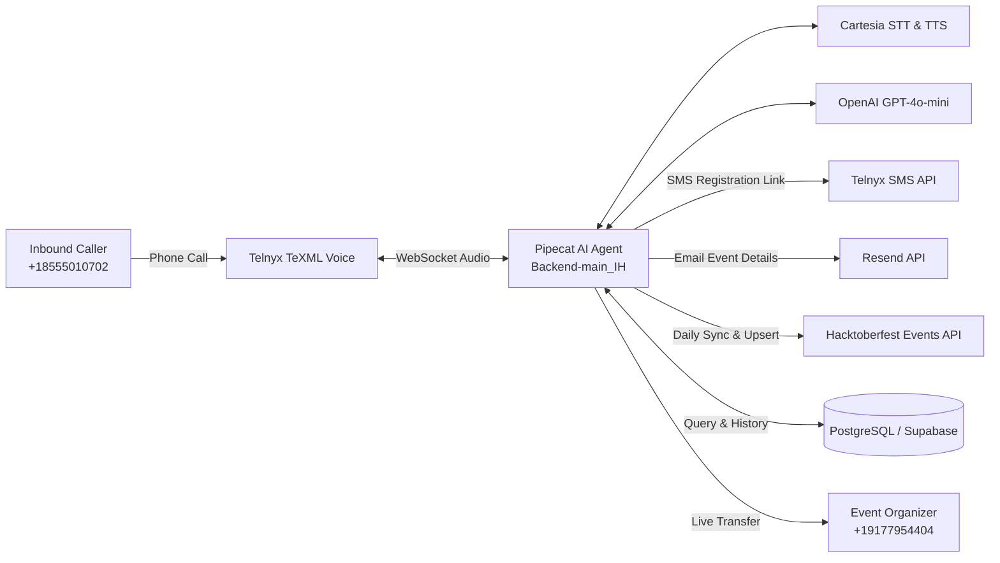

# HackWhisper — AI Hacktoberfest Voice Calling Agent

[](https://www.python.org/)
[](https://www.postgresql.org/)
[](https://telnyx.com/)
[](https://cartesia.ai/)
[](https://hacktoberfest.com/)

A real-time AI voice calling agent that provides callers with information about Hacktoberfest events, answers questions, and on request delivers event details and registration links via **Email** or **SMS**.

---

## 🎯 Main Features

1. **Inbound Voice Calling:** Users call the AI agent over phone lines (via Telnyx or SignalWire).
2. **Event Q&A:** Answers questions about Hacktoberfest rules, rewards, eligibility, and schedules.
3. **City-Wise Event Search:** Discovers local and virtual events by city, region, or format.
4. **Registration Delivery:** Sends official event links directly via **SMS text** or **Email** upon request.
5. **Automatic Event Management (Daily Full Fetch + Upsert + Historical Versioning):**
   - Automatically syncs every 24 hours from the official [Hacktoberfest MLH Events API](https://hacktoberfest-api.mlh.com/api/events).
   - Upserts new events into PostgreSQL.
   - Archives previous event states in an `event_history` table on update (never deletes older events).
   - Records execution audit trails in `event_sync_logs`.
6. **AI Response Method:** Structured database queries and GPT Function Calling (`search_events`, `get_event_details`, `get_registration_link`, `send_event_email`, `send_event_sms`).

---

## ⚡ System Architecture



---

## 🚀 Getting Started

### Backend Execution
```powershell
cd Backend-main_IH
python -m venv venv
.\venv\Scripts\Activate.ps1
pip install -r requirements.txt
Copy-Item .env.example .env
python bot.py
```

---

## 💾 Hardware & RAM Requirements

- **Minimum:** **1 GB to 2 GB RAM** (Runs on basic cloud droplets/VPS).
- **Recommended for Production:** **2 GB to 4 GB RAM** (Accommodates concurrent calls, background daily sync, and audio pipeline with low latency).
